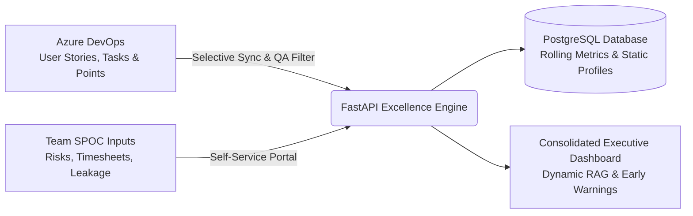
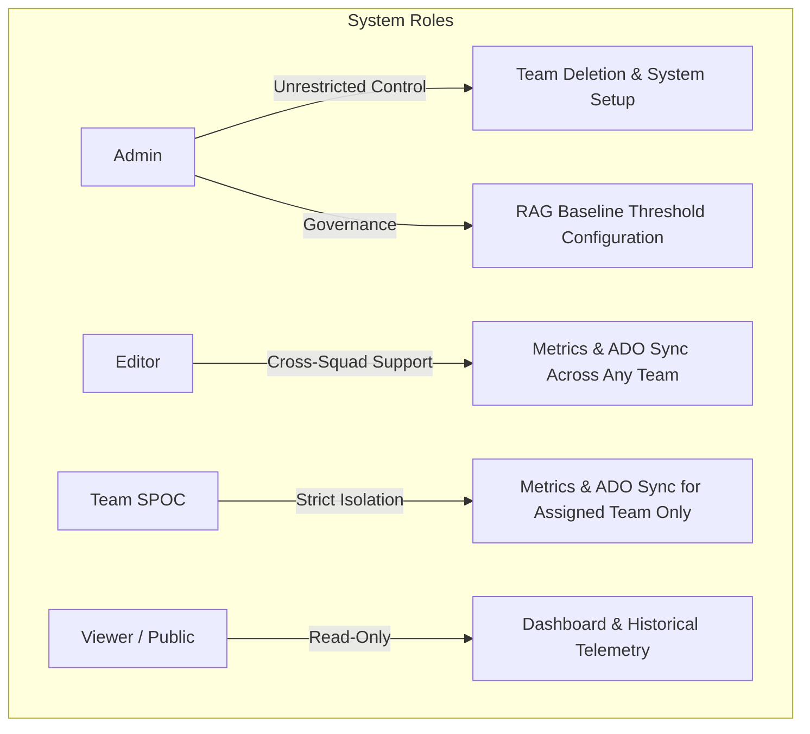
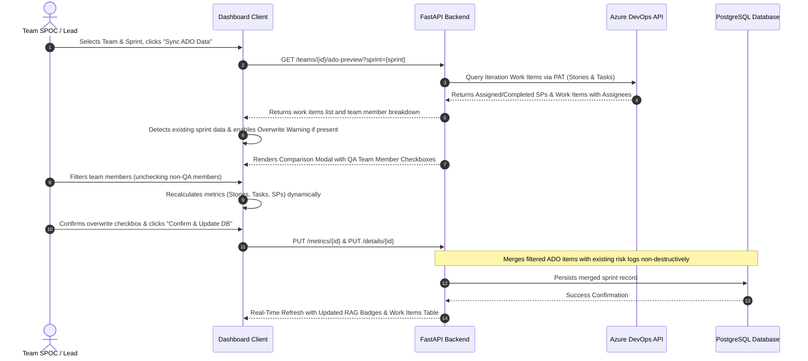

# CAT Delivery Excellence Tracker
### Enterprise Delivery Intelligence & Agile Health Governance


---

## Executive Summary & Value Proposition

In modern enterprise delivery environments, leadership and program offices face a persistent challenge: **delivery data is fragmented**. Quantitative sprint telemetry sits locked inside Azure DevOps, while qualitative program health—defect leakages, operational risks, governance compliance, and timesheets—lives in disconnected spreadsheets.

The **CAT Delivery Excellence Tracker** bridges this divide. It delivers a unified, executive-grade governance engine that:

* **Eliminates Manual Reporting Overhead:** Replaces error-prone manual spreadsheets with automated, one-click synchronization directly from Azure DevOps (ADO) REST APIs.
* **Empowers Targeted QA Ingestion:** Features selective team member filtering so that non-QA items can be excluded, ensuring velocity and committed points reflect actual QA effort.
* **Distinguishes User Stories vs. Tasks:** Provides end-to-end classification of work items into Stories and Tasks with color-coded badges, separate counts, and type-aware filtering.
* **Separates Static Capabilities from Sprint Telemetry:** Decouples persistent team profiles (tooling, maturity, static program health) from rolling sprint metrics to eliminate redundant re-entry.
* **Proactively Mitigates Risks via Dynamic RAG:** Employs configurable Red/Amber/Green (RAG) thresholds to automatically identify project anomalies, delivery spillovers, and defect spikes before they become client-facing escalations.
* **Guarantees Governance via Multi-Tier RBAC:** Strict separation of duties across administrators, delivery coordinators, and dedicated team Single Points of Contact (SPOCs).
* **Protects Qualitative Context Non-Destructively:** Merges automated sprint statistics into qualitative notes and risk logs with built-in overwrite safeguards.



---

## 🌟 Core Product Capabilities

```mermaid
graph TD
    Root["CAT Delivery Tracker"]
    
    Root --> V["Executive Visualizations"]
    V --> V1["Sprint Overview Grid"]
    V --> V2["Automated Early Warning System"]
    V --> V3["Tabbed Domain Deep Dives"]
    V --> V4["User Story vs Task Badges"]
    
    Root --> A["Azure DevOps Integration"]
    A --> A1["Live Iteration Sync"]
    A --> A2["Selective QA Member Filter"]
    A --> A3["Interactive Review Modal"]
    A --> A4["Sprint Overwrite Safeguards"]
    
    Root --> S["Data Separation Architecture"]
    S --> S1["Rolling Sprint Delivery"]
    S --> S2["Static Team Profiles"]
    S --> S3["Dynamic Details Editor"]
    
    Root --> R["Dynamic RAG Engine"]
    R --> R1["Configurable Baselines"]
    R --> R2["Directional Metric Logic"]
    R --> R3["Team-Specific Tolerances"]
    
    Root --> G["Governance & Security"]
    G --> G1["Role-Based Access Control"]
    G --> G2["Single SPOC Enforcement"]
    G --> G3["Encrypted Credentials"]
```



### 1. Executive Dashboard & Visual Intelligence
* **Unified Portfolio Grid:** Single-pane-of-glass overview across all agile teams for any selected sprint.
* **Automated Early Warning System (EWI):** Surfaces critical delivery flags in real time, pinpointing squads falling behind on velocity or exceeding risk thresholds.
* **Global Sprint Filter:** Instantaneous portfolio-wide time-travel: compare velocity, spill-overs, and compliance across past and present sprints.
* **Domain Deep-Dives:** Tailored analytical views for **Delivery**, **Program Health**, **Capability & Automation**, and **Compliance**.
* **Work Item Classification:** Instant visual distinction between **User Stories** (blue pill badge) and **Tasks** (amber pill badge), complete with real-time search filtering.

### 2. Azure DevOps (ADO) Live Synchronization & Selective Ingestion
* **One-Click Telemetry:** Ingests completed Story Points, committed stories, and tasks directly from Azure DevOps REST endpoints (`[System.WorkItemType] IN ('User Story', 'Task')`).
* **QA Team Member Filtering:** Multi-select checklist allows SPOCs to include only QA personnel work items, automatically recalculating assigned and completed totals.
* **Sprint Overwrite Safeguards:** Automatically detects existing sprint records and mandates explicit confirmation before updating the database.
* **Non-Destructive Merging:** Combines automated ADO data with manually entered qualitative fields (e.g., defect leakage, timesheets, risk notes) without data loss.

### 3. Static Profile vs. Rolling Sprint Data Separation
* **Rolling Sprint Metrics:** Delivery throughput, committed points, spill-overs, and timesheet compliance captured uniquely per sprint.
* **Static Team Profiles (`team_profiles`):** Static capabilities, CI/CD maturity, cloud proficiency, automation tooling, and program health baselines (Prod Incidents, SOW Milestones, Escalations, Open Risks) maintained once and updated on demand.
* **Multiline & Pipe Integrity:** US Assigned Details editor preserves internal pipes (`|`) within user story titles while supporting `||` delimiters for single-line multi-story entries.

### 4. Dynamic RAG Governance & Baselining
* **No Rigid Rules:** Allows leadership to tailor baseline expectations and variance tolerances per metric.
* **Directional Awareness:**
  * **"Higher is Better":** Story Points Assigned, Story Points Completed, Automation Coverage, Stability.
  * **"Lower is Better":** Stories Pushed (Spillovers), Defect Leakage, Production Incidents, Open Risks, Escalations.
* **Tailored Maturity Models:** Mature engagements can be held to tighter thresholds, while newer squads adopt progressive maturity curves.

---

## 📊 Comprehensive Metric & KPI Taxonomy

| Domain | Key Metric | Calculation / Source | Direction | Impact on RAG Status |
| :--- | :--- | :--- | :---: | :--- |
| **Delivery** | **Story Points Assigned** | ADO Iteration committed SPs (QA filtered) | Higher | Highlights sprint over/under-commitment |
| **Delivery** | **Story Points Completed** | ADO Closed / Done SPs (QA filtered) | Higher | Determines velocity health and throughput |
| **Delivery** | **User Stories & Tasks** | Work items classified by type | Neutral | Scope transparency and task breakdown |
| **Delivery** | **User Stories Pushed** | Rolled over stories / spillovers | Lower | Early warning for estimation or scope drift |
| **Program Health** | **Defect Leakage (%)** | Production bugs vs total defects | Lower | Measures QA effectiveness and test gates |
| **Program Health** | **Production Incidents** | Sev-1 / Sev-2 live incidents | Lower | Critical service stability indicator |
| **Program Health** | **Open Risks & Escalations** | Logged impediments / client flags | Lower | Triggers immediate leadership intervention |
| **Automation** | **Automation Coverage (%)** | Automated test count / Total tests | Higher | Assesses continuous testing maturity |
| **Automation** | **Automation Stability (%)** | Pipeline pass rates | Higher | Gauges build reliability and flakiness |
| **Compliance** | **Timesheet Submission** | Deloitte & Tenrox completions | Higher | Ensures billing and regulatory compliance |

---

## 👥 Role-Based Access Control (RBAC) Matrix

Security and data integrity are enforced at both API and UI levels:



| Action / Capability | `admin` | `editor` | `team_spoc` | Viewer |
| :--- | :---: | :---: | :---: | :---: |
| **View Dashboard & Early Warnings** | Full | Full | Full | Read-Only |
| **Create Sprints Globally** | ✅ | ✅ | ✅ | ❌ |
| **Edit Metrics & Risks for Assigned Team** | ✅ | ✅ | ✅ | ❌ |
| **Edit Metrics & Risks for Other Teams** | ✅ | ✅ | ❌ *(HTTP 403)* | ❌ |
| **Sync ADO Iteration Data** | Any Team | Any Team | Assigned Team Only | ❌ |
| **Modify RAG Baselines & Tolerances** | ✅ | ❌ | ❌ | ❌ |
| **Create & Delete Teams** | ✅ | ❌ | ❌ *(Registration Only)* | ❌ |

> [!IMPORTANT]
> **Single SPOC Governance:** To prevent conflicting updates, the system strictly enforces a **1:1 mapping** between an active `team_spoc` and a team engagement. A team cannot have multiple competing SPOC accounts.
> 
> For an exhaustive endpoint-by-endpoint security breakdown and token lifecycle details, see the dedicated [Roles & Access Guide](ROLES_AND_ACCESS.md).

---

## 🔄 Azure DevOps Synchronization Architecture



---

## 🛠️ Technical Stack & Security Posture

* **Backend Engine:** [FastAPI](https://fastapi.tiangolo.com/) providing high-throughput, asynchronous REST endpoints with strict Pydantic payload validation.
* **Database & ORM:** [PostgreSQL](https://www.postgresql.org/) managed via [SQLAlchemy](https://www.sqlalchemy.org/) relational modeling with cascade support. See [Database Structure & Schema Guide](DATABASE_STRUCTURE.md) for full ER diagrams, column types, and disaster rebuild scripts.
* **Frontend Presentation:** Zero-build, responsive Vanilla JavaScript frontend driven by [Tailwind CSS](https://tailwindcss.com/) and [Tremor](https://www.tremor.so/) design principles.
* **Security & Tokens:**
  * Password hashing using cryptographic algorithms via `passlib`.
  * Stateless session authentication powered by JSON Web Tokens (`PyJWT`).
  * ADO Personal Access Tokens (PATs) scoped to individual team configurations.
* **Containerization:** Production Docker Compose architecture with DNS fallbacks and health dependencies.

---

## 🚀 Quick Launch Reference

### Local Development
```powershell
# 1. Start Backend
cd backend
pip install -r requirements.txt
uvicorn main:app --reload

# 2. Serve Frontend (Separate Terminal)
python -m http.server 8080 --directory frontend
```

### Production (Docker Compose)
```bash
docker compose up -d --build
```

* **Frontend Dashboard:** [http://localhost:8080](http://localhost:8080)
* **Backend API & Swagger Docs:** [http://localhost:8000/docs](http://localhost:8000/docs)
