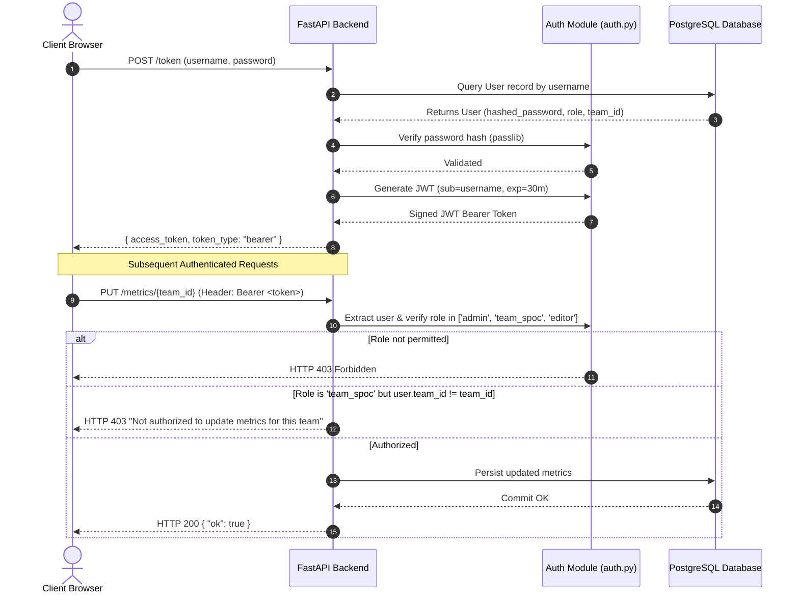
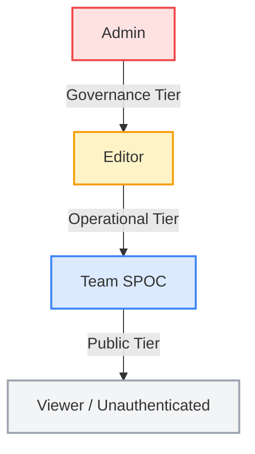

# Role-Based Access Control (RBAC) & Permissions Guide
### Security Architecture, Access Matrices & Operational Governance


---

## 1. Authentication & Authorization Architecture

The **CAT Delivery Excellence Tracker** implements a dual-layer security model combining **stateless JWT bearer tokens** with **strict endpoint-level role verification** and **UI component masking**:



### Key Security Components
* **Password Hashing:** Passwords are never stored in plaintext. They are cryptographically hashed using PBKDF2/Bcrypt via `passlib.context.CryptContext` in [backend/auth.py](file:///D:/Coding Workspace/VS Code workspace/PythonFirst/ADO-AI-Integration/backend/auth.py#L13-L20).
* **Token Issuance:** Signed HS256 tokens are issued via `/token` and validated per request using FastAPI's dependency injection (`Depends(auth.get_current_user)`).
* **Role Dependency Guard:** Endpoints use the `require_role(allowed_roles)` higher-order dependency in [backend/auth.py](file:///D:/Coding Workspace/VS Code workspace/PythonFirst/ADO-AI-Integration/backend/auth.py#L52-L60) to reject unauthorized callers before business logic executes.

---

## 2. User Persona Roles Breakdown

The platform defines **4 access tiers**:



### 1. `admin` (System Administrator)
* **Scope:** Entire system.
* **Responsibilities:** Platform governance, onboarding/offboarding engagements, baseline threshold management.
* **Exclusive Privileges:**
  * Can access the **Configurations** tab in the UI to modify baseline RAG thresholds (expected targets and variance tolerances for story points, defect leakages, automation stability, etc.).
  * Can permanently delete teams (`DELETE /teams/{id}`), which cascades deletion across all historical metrics, qualitative details, and custom configurations.
  * Can update or sync metrics for **any** team.

### 2. `editor` (Cross-Team Operational Lead)
* **Scope:** All teams (without administrative destruction rights).
* **Target Users:** PMO Leads, Agile Coaches, Delivery Excellence Coordinators supporting multiple squads.
* **Capabilities:**
  * Can enter metrics, log risks, configure ADO credentials, and trigger ADO syncs for **any team** across the organization.
  * Can create global sprints.
* **Restrictions:**
  * **Cannot** delete teams.
  * **Cannot** modify RAG baseline scoring formulas or threshold tolerances.

### 3. `team_spoc` (Single Point of Contact)
* **Scope:** Strictly isolated to their assigned `team_id`.
* **Target Users:** Squad Scrum Masters, Project Tech Leads, Delivery SPOCs.
* **Capabilities:**
  * Can view global dashboard telemetry.
  * Can create global sprints.
  * Can update sprint metrics, details, and trigger ADO preview/sync **only for their assigned team**.
* **Restrictions:**
  * Cannot view or modify another team's ADO PAT or update their sprint metrics.
  * Cannot access the RAG Configurations tab.
  * Cannot delete teams.

### 4. `viewer` / Unauthenticated (Public Read-Only)
* **Scope:** Read-only access to published metrics.
* **Target Users:** Executives, Client Stakeholders, Cross-functional Observers.
* **Capabilities:**
  * Can filter the portfolio dashboard by sprint.
  * Can inspect Delivery, Health, Capability, and Compliance drill-down views.
* **Restrictions:**
  * No access to data entry forms, sync buttons, or configuration menus.

---

## 3. Comprehensive Permissions & Endpoints Matrix

| HTTP Method | API Route | Description | `admin` | `editor` | `team_spoc` | Viewer |
| :---: | :--- | :--- | :---: | :---: | :---: | :---: |
| `GET` | `/metrics` | View all delivery metrics for all teams | ✅ | ✅ | ✅ | ✅ |
| `GET` | `/details` | View qualitative notes, risks, and health details | ✅ | ✅ | ✅ | ✅ |
| `GET` | `/teams` | List all active team engagements | ✅ | ✅ | ✅ | ✅ |
| `GET` | `/configs` | View current RAG baseline thresholds | ✅ | ✅ | ✅ | ✅ |
| `GET` | `/sprints` | List all global sprints | ✅ | ✅ | ✅ | ✅ |
| `POST` | `/register` | Register a new user / SPOC account | ✅ | ✅ | ✅ | ✅ |
| `POST` | `/token` | Authenticate and obtain JWT Bearer Token | ✅ | ✅ | ✅ | ✅ |
| `GET` | `/users/me` | Fetch authenticated user profile & role | ✅ | ✅ | ✅ | ❌ |
| `POST` | `/sprints` | Create a new sprint globally | ✅ | ✅ | ✅ | ❌ |
| `PUT` | `/metrics/{team_id}` | Update delivery metrics (SP, Spillovers) | ✅ Any | ✅ Any | ✅ *Own Team Only* | ❌ |
| `PUT` | `/details/{team_id}` | Update qualitative details (Risks, Leakage) | ✅ Any | ✅ Any | ✅ *Own Team Only* | ❌ |
| `PUT` | `/teams/{team_id}/ado-config` | Update ADO Org, Project, Area, PAT | ✅ Any | ✅ Any | ✅ *Own Team Only* | ❌ |
| `GET` | `/teams/{team_id}/ado-preview` | Live pull & preview of ADO iteration work items | ✅ Any | ✅ Any | ✅ *Own Team Only* | ❌ |
| `POST` | `/teams` | Register a new team engagement | ✅ | ❌ | ❌ *(Registration Only)* | ❌ |
| `DELETE` | `/teams/{team_id}` | Permanently delete team and cascade all data | ✅ | ❌ | ❌ | ❌ |
| `POST` | `/teams/{team_id}/configs` | Initialize team RAG baseline thresholds | ✅ | ❌ | ❌ | ❌ |
| `PUT` | `/teams/{team_id}/configs` | Update team RAG baseline thresholds | ✅ | ❌ | ❌ | ❌ |

---

## 4. Deep Dive: SPOC Team Isolation & Governance

To ensure accurate, non-conflicting delivery reporting, the system enforces **Single SPOC Governance**:

### 1. One Active SPOC per Team
During user registration in [backend/main.py](file:///D:/Coding Workspace/VS Code workspace/PythonFirst/ADO-AI-Integration/backend/main.py#L28-L39), if a user registers as `team_spoc` for an existing team, the backend verifies whether a SPOC already exists:
```python
existing_spoc = db.query(models.User).filter(
    models.User.team_id == team_id, 
    models.User.role == "team_spoc"
).first()
if existing_spoc:
    raise HTTPException(
        status_code=400, 
        detail="spoc already exists please ask admin to remove existing spoc before mapping new spoc to team"
    )
```

### 2. Dual-Layer Enforcement (API + UI)
* **Backend Authorization Check:** Every write endpoint (`/metrics/{team_id}`, `/details/{team_id}`, `/ado-config`, `/ado-preview`) validates:
  ```python
  if user.role == "team_spoc" and user.team_id != team_id:
      raise HTTPException(status_code=403, detail="Not authorized to update metrics for this team")
  ```
* **Frontend Scope Locking:** In [frontend/cat_dashboard.html](file:///D:/Coding Workspace/VS Code workspace/PythonFirst/ADO-AI-Integration/frontend/cat_dashboard.html#L2140-L2148), when a SPOC clicks **Update Team Data**, the team selection dropdown is filtered strictly to their assigned team:
  ```javascript
  teamsList.forEach(t => {
      if (userRole === 'team_spoc' && t.id !== userTeamId) return;
      // only own team option is appended
  });
  ```

---

## 5. Seeded Accounts & Testing Credentials

For local development and testing, default seed accounts are configured in [backend/seed.py](file:///D:/Coding Workspace/VS Code workspace/PythonFirst/ADO-AI-Integration/backend/seed.py):

| Username | Default Password | Role | Team Scope | Primary Test Use Case |
| :--- | :--- | :--- | :--- | :--- |
| **`admin`** | `admin123` | `admin` | Global / All | Configure RAG thresholds, delete teams, manage global settings |
| **`spoc`** | `spoc123` | `team_spoc` | Team-bound | Validate single-team editing, ADO sync, and cross-team lockouts |

> [!CAUTION]
> In production deployments, default credentials should be immediately updated via database migration or an administrative password reset utility.
