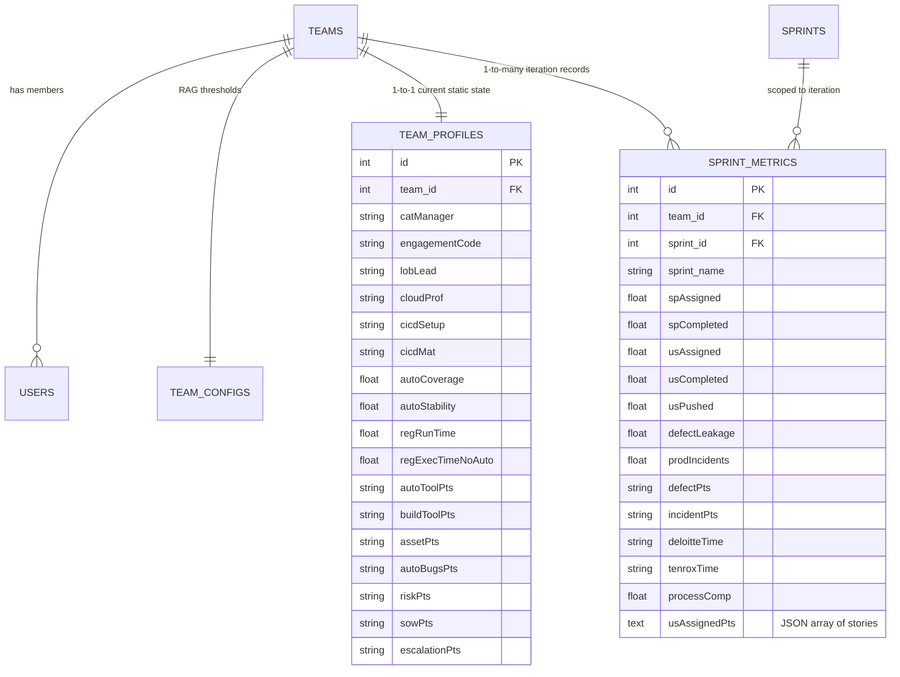

# Sprint Data & Static Data Separation Analysis

## Executive Summary

As the Cat Digital ADO Integration platform evolves from a manual spreadsheet dashboard into an automated, Azure DevOps-connected system, the boundary between **Static Team Data** (capabilities, tools, automation maturity, general info) and **Sprint/Iteration Data** (user stories, story points, velocity, compliance) must be clearly formalized.

Currently, both static and iteration data are combined into single rows across `metrics` and `details` keyed by `(team_id, sprint_id)`. When a SPOC selects a new sprint (e.g., Sprint 3), static fields that were not re-entered for that specific sprint display as empty (`— No data available`), while editing a team-level field like "Cat Manager" or "Cloud Proficiency" only updates that single sprint record.

This document analyzes the problem, categorizes every field into its proper lifecycle, compares three architectural solutions, and provides a clear recommendation for confirmation prior to implementation.

---

## 1. Field Classification: Static vs. Sprint Data

```
+---------------------------------------------------------------------------------------+
|                                    DATA TAXONOMY                                      |
+---------------------------------------------------------------------------------------+
|  STATIC DATA (Team-Level / Infrequent SPOC Updates)                                    |
|  - General Info: Cat Manager, Engagement Code, LOB Lead, SPOC                         |
|  - Capabilities: Cloud Proficiency, CI/CD Pipeline Setup, Tools Required              |
|  - Automation: Coverage %, Stability %, Reg Run Time, Manual Time, Assets Reused       |
|  - Program Health (Rolling): SOW Milestones, Open Risks & Issues, Escalations RCA     |
+---------------------------------------------------------------------------------------+
|  SPRINT DATA (Iteration-Specific / Pulled from ADO or Set Per Sprint)                 |
|  - Delivery Velocity: Story Points Assigned, Story Points Completed, US Pushed        |
|  - Delivery Scope: US Assigned Count, US Completed Count                              |
|  - Work Item Details: User Stories JSON (IDs, Titles, Story Points, Assignees, States) |
|  - Sprint Compliance: Deloitte Time, Tenrox Time, Process Compliance %                 |
|  - Sprint Quality: Defect Leakage (Iteration), Production Incidents (Iteration)       |
+---------------------------------------------------------------------------------------+
```

### Complete Field Categorization Matrix

| Field Name | Current Table | Classification | Update Frequency | Primary Source | Rationale |
| :--- | :--- | :--- | :--- | :--- | :--- |
| `catManager` | `details` | **Static** | Rare | SPOC Manual | Engagement organizational hierarchy does not change sprint-to-sprint. |
| `engagementCode` | `details` | **Static** | Rare | SPOC Manual | Fixed contract identifier. |
| `lobLead` | `details` | **Static** | Rare | SPOC Manual | Organizational leader. |
| `spoc` | `teams` / `metrics` | **Static** | Rare | SPOC Manual | Designated team representative. |
| `cloudProf` | `details` | **Static** | Monthly/Quarterly | SPOC Manual | Cloud maturity is an organizational capability, not a 2-week metric. |
| `cicdSetup` | `details` | **Static** | Quarterly | SPOC Manual | Infrastructure setup state. |
| `cicdMat` | `details` | **Static** | Quarterly | SPOC Manual | Pipeline maturity rating. |
| `autoToolsReq` / `autoToolPts` | `metrics`/`details` | **Static** | As needed | SPOC Manual | Tooling requirements and licenses remain open until resolved. |
| `buildToolsReq` / `buildToolPts` | `metrics`/`details` | **Static** | As needed | SPOC Manual | Build tool requirements. |
| `autoCoverage` | `metrics` | **Static** | Monthly | SPOC Manual | Total test automation coverage across the repository. |
| `autoStability` | `metrics` | **Static** | Monthly | SPOC Manual | Test suite stability % over time. |
| `regRunTime` | `metrics` | **Static** | Monthly | SPOC Manual | Automated test suite execution duration. |
| `regExecTimeNoAuto` | `metrics` | **Static** | Monthly | SPOC Manual | Manual test cycle baseline. |
| `kt` / `ktPrep` | `metrics`/`details` | **Static** | As needed | SPOC Manual | Knowledge transfer documentation state. |
| `assets` / `assetPts` | `metrics`/`details` | **Static** | Rolling | SPOC Manual | Cumulative reusable assets created. |
| `autoBugs` / `autoBugsPts` | `metrics`/`details` | **Static** | Rolling | SPOC Manual | Total bugs in automation code. |
| `openRisks` / `riskPts` | `metrics`/`details` | **Static (Rolling)** | Ongoing | SPOC Manual | Program risks span multiple sprints until mitigated. |
| `sowMilestones` / `sowPts` | `metrics`/`details` | **Static (Rolling)** | Milestone | SPOC Manual | Contractual deliverables and target delivery dates. |
| `escalations` / `escalationPts` | `metrics`/`details` | **Static (Rolling)** | Ongoing | SPOC Manual | Root-cause analysis and operational escalations. |
| **`spAssigned`** | `metrics` | **Sprint** | Every Sprint | **ADO Sync** | Story points committed in the specific iteration. |
| **`spCompleted`** | `metrics` | **Sprint** | Every Sprint | **ADO Sync** | Story points completed in the specific iteration. |
| **`usAssigned`** | `metrics` | **Sprint** | Every Sprint | **ADO Sync** | Work item count in the iteration. |
| **`usCompleted`** | `metrics` | **Sprint** | Every Sprint | **ADO Sync** | Work items closed/resolved in the iteration. |
| **`usPushed`** | `metrics` | **Sprint** | Every Sprint | SPOC / ADO | Stories not completed and pushed to next sprint. |
| **`usAssignedPts`** | `details` | **Sprint** | Every Sprint | **ADO Sync** | Structured JSON of user stories with individual points & assignees. |
| **`deloitteTime`** | `details` | **Sprint** | Every Sprint | SPOC Manual | Timesheet compliance for the sprint cycle. |
| **`tenroxTime`** | `details` | **Sprint** | Every Sprint | SPOC Manual | Caterpillar Tenrox timesheet compliance for the cycle. |
| **`processComp`** | `details` | **Sprint** | Every Sprint | Calculated | Automated % score based on timesheet compliance. |
| **`defectLeakage`** | `metrics`/`details` | **Sprint** | Every Sprint | SPOC / ADO | Defects identified in production/QA during this sprint. |
| **`prodIncidents`** | `metrics`/`details` | **Sprint** | Every Sprint | SPOC / ADO | Production incidents occurring in this sprint window. |

---

## 2. Core Question: How to Capture and Display Sprint Data?

> **User Question:** *"how do we capture and display sprint data ? do we update all the fields each sprint or do we just keep 1 updated data record per team and keep showing that each sprint unless updated by a spoc."*

### Analysis of the Two Operating Models

#### Model 1: Clone Everything Every Sprint (Snapshot Approach)
- **Concept:** Every time a new sprint starts, copy all 40+ fields from Sprint $N$ to Sprint $N+1$.
- **Downsides:**
  1. **Data Desynchronization:** If the SPOC updates the Cat Manager or Automation Tool list in Sprint 4, Sprints 1, 2, and 3 still have outdated information.
  2. **High Update Friction:** The SPOC feels burdened because opening "Update Team Data" for a new sprint shows empty fields or forces them to re-verify static data that hasn't changed.
  3. **Storage & Maintenance Waste:** 90% of the columns in every new sprint row are duplicates of the previous sprint.

#### Model 2: Normalized Team Profile + Sprint Iteration History (Recommended)
- **Concept:**
  - **1 Active Static Record Per Team:** Automation, Capability, Program Health, and General Information live in a team-level state table (1 record per team). When a SPOC updates this record, it represents the team's current capabilities across the entire portal.
  - **1 Record Per Team Per Sprint:** Delivery metrics, User Stories JSON, Defect Leakage, and Compliance live in iteration-specific records keyed by `(team_id, sprint_id)`.
- **User Experience on Dashboard:**
  - When the user selects **Sprint 3** in the sprint dropdown:
    - The **Delivery** tab displays Sprint 3's ADO-synced stories, story points, and velocity.
    - The **Compliance** tab displays Sprint 3's timesheet compliance.
    - The **Capability**, **Automation**, and **Health** tabs display the team's current active profile. They *never go blank* just because a new sprint was created!
  - When the SPOC opens the **Update Team Data** modal:
    - Static tabs (Capability, Automation, Health, General Info) do not ask for a sprint. Editing them updates the team's state once.
    - Sprint tabs (Delivery, Compliance, ADO Sync) are bound to the selected sprint.

---

## 3. Architecture Options Comparison

| Dimension | Strategy A: Full Snapshot (Clone on Sprint) | Strategy B: Normalized Tables (`team_profiles` + `sprint_metrics`) | Strategy C: Layered Fallback with Existing Schema |
| :--- | :--- | :--- | :--- |
| **Database Schema** | Keep `metrics` & `details`, clone rows per sprint. | Create `team_profiles` table; prune `metrics`/`details` to sprint fields. | Keep existing tables; use `sprint_id IS NULL` for static team profile. |
| **API Complexity** | Low (current PUT /metrics/{id} with sprint_id). | Clean RESTful endpoints (`/teams/{id}/profile`, `/teams/{id}/sprints/{sprint_id}`). | Medium (backend merges static row with sprint row on query). |
| **Frontend Impact** | High maintenance for SPOC; static tabs go blank if not cloned. | Clear distinction between team settings and sprint entries. | Minimal UI changes; instant persistence across all sprints. |
| **Data Integrity** | Poor (stale copies across past sprints). | Strict relational normalization. | High (single source of truth for static data). |
| **Migration Risk** | Zero DDL change, but high data-quality risk. | Requires DDL table migration & data migration. | Zero DDL risk; query-level enhancement. |

---

## 4. Proposed Solution: Strategy B (Normalized Schema) with Phased Implementation

To provide a long-term architecture that scales cleanly with Azure DevOps sync, we propose **Strategy B**:

### Target Schema Architecture



### Proposed API Endpoints

1. **Static Profile API:**
   - `GET /teams/{team_id}/profile`: Returns current static capabilities, automation metrics, and general info.
   - `PUT /teams/{team_id}/profile`: SPOC updates static data once; automatically reflects across all sprint views.

2. **Sprint Metrics API:**
   - `GET /teams/{team_id}/sprints/{sprint_id}`: Returns delivery metrics, user stories JSON, defect leakage, and compliance for that specific sprint.
   - `PUT /teams/{team_id}/sprints/{sprint_id}`: Saves iteration-specific metrics.
   - `GET /teams/{team_id}/ado-preview`: Syncs ADO iteration work items directly into the sprint payload.

3. **Dashboard Aggregator API (Composite):**
   - `GET /dashboard/{team_id}?sprint_id={sprint_id}`: Returns a clean composite object:
     ```json
     {
       "team_id": 11,
       "sprint_id": 3,
       "static_profile": { "catManager": "...", "cloudProf": "Yes", ... },
       "sprint_metrics": { "spAssigned": 50, "usAssigned": 50, "user_stories": [...], ... }
     }
     ```

---

## 5. UI/UX Workflow for the SPOC

1. **Main Dashboard:**
   - Selecting a sprint from `mainSprintSelect` refreshes **Delivery** (Velocity, Stories Table), **Compliance** (Timesheets), and **Quality** (Sprint Defects).
   - **Capability & Gaps**, **Automation**, and **Problem & Value** remain visible and populated from the team's active profile without disappearing.

2. **Update Team Data Modal:**
   - **Tab 1: Team Profile (Static):**
     - Single view for General Information, Capability & Tools, Automation Suite, and Rolling Risks.
     - No sprint selector needed. One click saves the team's ongoing state.
   - **Tab 2: Sprint Delivery & ADO Sync (Dynamic):**
     - Sprint selector dropdown (`Sprint 1`, `Sprint 2`, `Sprint 3`).
     - "Sync from Azure DevOps" button fetches the iteration's user stories, story points, and assignees directly.
     - Inputs for Sprint Defect Leakage, Prod Incidents, and Timesheets (`deloitteTime`, `tenroxTime`).

---

## 6. Implementation Plan (Pending Confirmation)

1. **Step 1: Database Migration Script (`scripts/migrate_static_sprint_data.py`)**
   - Create `team_profiles` table.
   - Populate `team_profiles` by extracting the latest non-null values for each team from `metrics` and `details`.
   - Add a database view or preserve backward-compatible columns during transition.

2. **Step 2: Backend API Updates (`backend/routers/` & `backend/main.py`)**
   - Implement `GET/PUT /teams/{id}/profile`.
   - Update `GET /teams/{id}/ado-preview` and `PUT /details` to target sprint-scoped tables.

3. **Step 3: Frontend Dashboard Refactoring (`frontend/cat_dashboard.html`)**
   - Update `renderAll()`, `renderCapability()`, `renderAutomation()`, and `renderValueMetrics()` to consume `team_profile`.
   - Update `renderDelivery()` and `renderCompliance()` to consume `sprint_metrics`.
   - Redesign the Update Modal to separate "Team Profile" from "Sprint Data".

---

## 7. Questions for User Confirmation

Before implementation begins, please confirm:

1. **Program Health Scope:** Should **Open Risks**, **SOW Milestones**, and **Escalations** be treated as **Static/Rolling** (single active team state), or do you want a historical record of risks saved per sprint?
2. **Defects & Incidents:** Are **Defect Leakage** and **Production Incidents** strictly iteration metrics (reset each sprint), or should there also be a cumulative total?
3. **Approval to Proceed:** Do you approve the Strategy B architecture (normalized `team_profiles` + `sprint_metrics`) to begin implementation?
